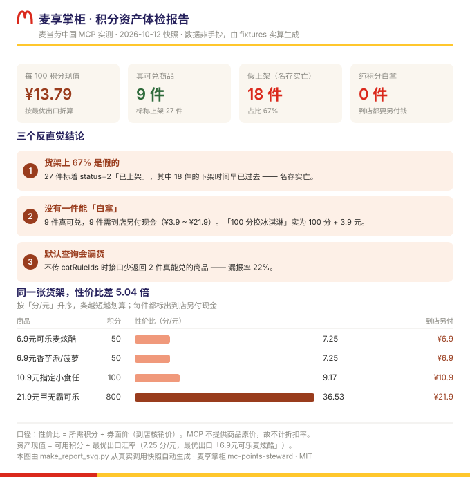
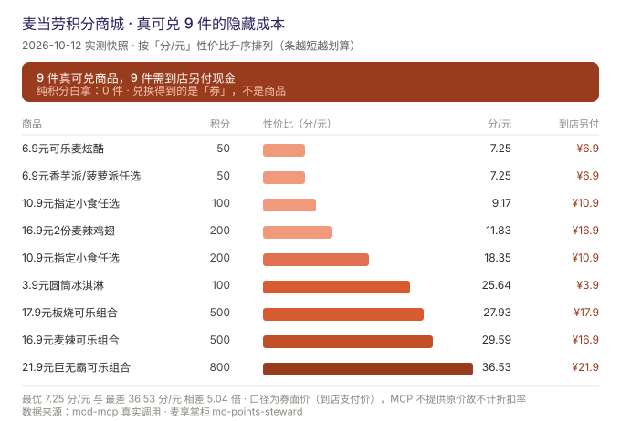

# 麦享掌柜 · mc-points-steward

> 一个替你打理麦当劳积分资产的 WorkBuddy Skill ——
> **查得清账、剔得掉假、算得出值、守得住手**。
>

[](https://open.mcd.cn/mcp/doc)
[](https://www.workbuddy.cn)
[](https://github.com/yurenpai/mc-points-steward/actions/workflows/verify.yml)
[](skill/scripts/)
[](LICENSE)

---


*↑ 横幅上的三个数字不是口号，是 `python skill/scripts/make_banner_svg.py` 从真实调用快照里算出来的。*

---



*↑ 这张图不是画的，是 `python skill/scripts/make_report_svg.py` 从真实调用快照里算出来自动生成的——每个数字都能复现。*

---

## 30 秒看懂它

打开麦当劳 App 的积分商城，一次默认查询返回 **50 件**商品——
其中 **26 件是现金商品**（派对、品鉴会、体验营，`point=0`），与积分无关；
真正的积分商品只有 24 件。

而这 24 件**还不是全部**：按 `catRuleIds` 逐一查询再合并，积分类实际有 **27 件**。

```
标着 status=2（上架）的积分商品              27 件
  ├─ 真能兑（下架时间还没到）                 9 件   ✅
  └─ 名存实亡（下架时间早已过去，仍显示上架）  18 件   ☠️  占 67%
```

更要命的是三件"你以为是这样、其实不是"的事：

| 陷阱 | 现象 | 后果 |
|---|---|---|
| **隐藏现金成本** 🔴 | 真可兑 9 件，**没有一件是纯积分白拿的**——「3.9元圆筒冰淇淋」100 分换的只是一张券，到店**还要再付 3.9 元** | 以为白拿，实际掏钱 |
| **同名陷阱** | 「10.9元指定小食任选」有两个 spuId：**100 分** 和 **200 分**，名字一字不差 | 界面上分不出来该选哪个 |
| **默认查询漏报** | 不带 `catRuleIds` 查商城，会**漏掉 2 件真能兑的商品**（3.9元圆筒冰淇淋、16.9元2份麦辣鸡翅） | 少报 22% 的可兑选项 |

麦享掌柜把这些全部算清楚，再摆到你面前。

---

## 它解决什么真问题

**积分是"沉默资产"。** 大多数人不知道自己有多少分、什么时候过期、换什么划算，直到过期清零。

更难的是——**商城界面本身不可信**：

1. **假上架**：`Nike Book 2 麦当劳特别联名款`（8888 分）仍显示"上架"，但它的兑换窗口是
   `2026-06-05 14:00 ~ 16:00`，**只有两小时**，早已结束。系统不改变 `status` 字段。
2. **隐藏现金成本**：积分商城里**没有任何一件是纯积分白拿的**（实测 9/9 全部需到店另付现金）。
   这笔钱记在 `skuList[].extTradePrice`，**列表接口里根本没有这个字段**——
   不调 `mall-product-detail` 就永远看不到。
3. **同名陷阱**：同一个名字，两个价格，界面上分不出来。查了详情才发现
   **它们根本不是同一个东西**（一个兑薯条/麦旋风，一个兑麦乐鸡/鸡翅）。
4. **默认查询不完整**：只调一次不带参数的接口，会漏掉五分之一的可兑商品。
5. **性价比无从判断**：积分商品的 `price` 字段**恒为 `"0"`**，商品名里的数字
   （`"6.9元可乐麦炫酷"` → 6.9 元）其实是**券后支付价**，不是市价。不解析就无法比较。

麦享掌柜的价值不在于"帮你下单"，而在于**把这套失真的数据还原成可信的账**。

### 实测：性价比差 5 倍，而且每件都要另付现金



2026-10-12 对 9 件真可兑商品逐一调详情后排序（数值越小越划算）：

```
  积分    商品                     分/元     到店另付
   50    6.9元可乐麦炫酷           7.25      ¥6.9     ← 最划算
   50    6.9元香芋派/菠萝派任选     7.25      ¥6.9
  100    10.9元指定小食任选        9.17      ¥10.9    兑：中薯条/奥利奥麦旋风
  200    16.9元2份麦辣鸡翅        11.83      ¥16.9
  200    10.9元指定小食任选        18.35      ¥10.9    兑：麦乐鸡-4块/麦辣鸡翅-2块/鸡排
  100    3.9元圆筒冰淇淋          25.64      ¥3.9
  500    17.9元板烧可乐组合        27.93      ¥17.9
  500    16.9元麦辣可乐组合        29.59      ¥16.9
  800    21.9元巨无霸可乐组合      36.53      ¥21.9    ← 最贵
```

同样是花积分，**最划算和最贵的单位成本差 5.04 倍**。而这个差异，App 里看不出来。

> ⚠️ **上表「分/元」的口径**：分母是**券面价**（到店支付价），不是商品市价。
> MCP 不提供原价，因此本 Skill **不计算"真实折扣率"**——宁可不算，也不编造。
> 它的用途是横向比较"同样 1 元券面价，哪件吃得积分最少"。

---

## 快速开始

### 1. 配置 mcd-mcp 连接器

在 WorkBuddy 中：左侧【专家·技能·连接器】→【连接器】→【自定义连接器】→【配置 MCP】。

复制 [`mcp-config.example.json`](mcp-config.example.json)，把 `${MCD_MCP_TOKEN}` 换成你自己的 Token：

```json
{
  "mcpServers": {
    "mcd-mcp": {
      "type": "streamablehttp",
      "url": "https://mcp.mcd.cn",
      "headers": {
        "Authorization": "Bearer ${MCD_MCP_TOKEN}"
      }
    }
  }
}
```

> ⚠️ **`Bearer ` 前缀必须有，且后面有一个空格。** 实测不带前缀会返回 `403 校验鉴权authToken必填`。
> Token 获取：登录 [open.mcd.cn](https://open.mcd.cn) → 手机号验证 → 控制台 → 激活 → 复制。

### 2. 安装 Skill

把 `skill/` 整个目录放到 WorkBuddy 的 skills 目录下：

```bash
# 用户级（所有项目可用）
cp -r skill/ ~/.workbuddy/skills/mc-points-steward/

# 或用仓库自带的安装校验脚本（含冒烟测试）
cd skill && python tests/test_install.py --install --smoke
```

### 3. 直接用

> 我有多少积分？
> 积分能换什么？哪个最划算？
> 积分抽奖值不值得抽？

---

## 功能清单

| # | 功能 | 用到的工具 | 说明 |
|:--:|---|---|---|
| **F1** | 积分账本 | `query-my-account` | 可用 / 累计 / 已用 / 已过期 / 冻结 / 本月·下月将过期，账目自洽校验 |
| **F2** | 商城去伪 | `mall-points-products` | 逐类目查询并按 spuId 合并，剔除假上架与现金商品 |
| **F3** | 性价比榜 | `rank_products.py` | 从商品名解析券面价，算「分/元」，升序排列 |
| **F3+** | **隐藏现金成本** | `mall-product-detail` | 补出 `extTradePrice`，标注"到店另付 ¥X"与"是否纯积分" |
| **F5** | 兑换下单 | `mall-product-detail` → `mall-create-order` | 全程二次确认，绝不擅自扣分 |
| **F6** | 抽奖参谋 | `query-lottery-info` | 奖池结构 + 期望值解读，资格只信 `drawDecision` |
| **F4** | 商品详情 | `mall-product-detail` | SKU / 兑换内容 / 隐藏现金成本 |
| **F7** | 奖品档案 | `query-my-prizes` | 中奖记录（区分"确认没有"与"没查到"） |
| **F8** | 活动日历 | `campaign-calendar` | 限定情报附属层，仅作补充，不占主线 |

---

## 设计亮点

### 1. 脚本只做确定性计算，判断留给 Agent

这是 Skill 分层的经典实践，也是本项目的核心工程决策：

| 层 | 职责 | 实现 |
|---|---|---|
| **脚本层** | 过滤、去重、解析、排序、格式化 | `scripts/rank_products.py`，纯 Python 标准库 |
| **Agent 层** | 解读、建议、话术、降级 | SKILL.md 工作流 + 模型推理 |

脚本**绝不输出主观判断**（不会说"这个划算"），只输出 `unit_price`、`days_left`、
`cash_on_top`、`name_traps` 这样的确定性事实。好处：结果可复现、可测试、可审计——
**280 条断言钉死行为**。

### 2. 假上架去伪：不是拍脑袋的功能

规则来自实测：`status == 2`（上架）**但** `downTime < now` → 名存实亡。

证据：Nike Book 2 联名款的兑换窗口 `2026-06-05 14:00:00 ~ 16:00:00`，**两小时**，早已结束，
至今仍返回 `status: 2`。周边类目（`2>8`）实测 3 件，**100% 已过期**。

这条规则把 27 件里的 18 件剔了出去——**67% 的"在售"是假的**。

### 3. 默认查询漏报：接口不会告诉你的事

`mall-points-products` 不带 `catRuleIds` 时返回 50 件，其中 **26 件是现金商品**（`point=0`），
积分商品只有 24 件——这 24 件里属于 `1>4` 商品券类目的仅 **22 件**。
单独查 `catRuleIds=1>4` 则返回 24 件。

**漏掉的那 2 件，恰好都是真能兑的。** 只调一次默认查询，就会少报 22% 的可兑选项。

所以本 Skill 强制**逐类目查询 + 按 spuId 合并**，并在输出的 `coverage` 段记录每份输入的增量贡献，
让"数据是否查全"这件事变得可追溯。

### 4. 隐藏现金成本：最容易被漏掉的一笔钱

`extTradePrice`（券核销额外支付金额）**只存在于 `mall-product-detail` 的 `skuList[]` 中**，
列表接口 `mall-points-products` **完全没有这个字段**。

2026-10-12 对真可兑的 9 件逐一调详情，结果：

| 指标 | 实测 |
|---|---:|
| 真可兑商品 | 9 件 |
| 需到店另付现金 | **9 件（100%）** |
| 纯积分白拿 | **0 件** |
| 另付金额区间 | ¥3.9 ~ ¥21.9 |
| `extTradePrice` 与商品名内数字恒等 | **9/9** |

这意味着：「3.9元圆筒冰淇淋」100 分换到的**不是冰淇淋**，而是一张"以 3.9 元购买冰淇淋"的券。
只看列表就推荐，等于对用户说"100 积分白拿一个冰淇淋"——**这是实质性误导**。

因此本 Skill 在 W2 流程里强制**对每件真可兑商品补调详情**，并在榜单每一行显示"到店另付 ¥X"。
未拿到详情时脚本**保持 `None` 而不填 0**：宁可不说，不可说错。

> 这条也顺带纠正了我自己前一版的错误结论：我曾把「10.9元指定小食任选」的
> 100 分 / 200 分判定为"选错就多付一倍"，并建议"选最低分那个"。
> 查完详情才发现两者**兑换内容不同**（薯条/麦旋风 vs 麦乐鸡/鸡翅），
> 而到店另付都是 10.9 元——**贵的那个未必是坑**。现在改为展示内容差异，让用户按想吃什么选。

---

## MCP 工具使用清单

实际调用 10 个工具（mcd-mcp 共开放 35 个）：

| 工具 | 用途 | 前置 |
|---|---|---|
| `query-my-account` | 积分账本（9 个字段） | — |
| `mall-points-products` | 商城商品列表，**按 `catRuleIds` 逐类目查** | — |
| `mall-product-detail` | 商品详情 / SKU / **`extTradePrice` 隐藏现金成本** | `spuId` |
| `mall-create-order` | 积分兑换下单（**未实调**，见下） | `skuId`+`spuCategory`+**用户明确确认** |
| `query-lottery-info` | 抽奖活动与奖池 | — |
| `draw-lottery` | 执行抽奖 | **用户明确说"抽"** |
| `query-my-prizes` | 我的奖品 | — |
| `mall-order-list` | 商城订单（实测为空） | — |
| `campaign-calendar` | 当月营销活动日历 | — |
| `now-time-info` | 校时（判过期前必调） | — |

> **`mall-create-order` 未实际调用**——调用即产生真实订单与券码，本项目不代为发起真实交易。
> 入参契约（`skuId` / `spuCategory` / `addressId` / `count`，仅支持 `shopId=2`）
> 与返回字段已从工具 schema 完整确认并记录在 `references/api_fields.md` 第 5 节。

详细的入参、返回字段、业务价值与调用链路见 [`MCP_INTEGRATION.md`](MCP_INTEGRATION.md)。

---

## 安全设计

`mall-create-order` / `draw-lottery` / `cancel-order` 是不可逆资产操作，四道闸：

1. 执行前输出完整摘要（商品名 / 积分 / 有效期）
2. 必须等用户明确说 **"确认" "换" "抽"** —— 说"看看""随便""先了解"一律不执行
3. 积分不足时客观提示，**绝不引导充值或消费**
4. 调用失败原样转述错误，**不重试、不猜测原因**

配置文件只使用环境变量占位符 `${MCD_MCP_TOKEN}`，**真实 Token 不出现在仓库任何文件中**。

---

## 目录结构

```
mc-points-steward/
├── README.md                  本文件
├── MCP_INTEGRATION.md         参赛必交：MCP 调用说明
├── CONTEST_DECLARATION.md     参赛必交：官方声明（内容不可改）
├── mcp-config.example.json    参赛必交：脱敏配置示例
├── workbuddy.md               参赛必交：WorkBuddy 开发实录
├── LICENSE                    MIT
├── .github/
│   └── workflows/
│       └── verify.yml         CI：每次推送自动跑四层自检（顶部徽章实时反映状态）
├── docs/
│   └── index.html             在线演示页（自包含，可直接部署 GitHub Pages）
├── assets/
│   ├── banner.svg            品牌横幅（深棕底 + 金拱门，README 首图）
│   ├── report-card.svg        积分资产体检报告卡（可截图发群）
│   ├── hidden-cost.svg        真可兑 9 件的隐藏现金成本图
│   ├── points-ladder.svg      积分解锁天梯（静态版）
│   ├── demo.gif               终端风演示动图（文字取自 demo.py 实跑）
│   └── points-ladder.gif      积分解锁天梯（动态版）
├── skill/
│   ├── SKILL.md               技能本体（工作流 / 数据陷阱 / 安全红线）
│   ├── scripts/
│   │   ├── rank_products.py   去伪 + 性价比 + 多类目合并 + 隐藏现金成本 + 同名陷阱 + 积分现值
│   │   ├── lottery_advice.py  奖池解析
│   │   ├── demo.py            离线演示（无 Token 可跑）
│   │   ├── make_banner_svg.py 物料：生成品牌横幅 SVG（数字零手抄）
│   │   ├── make_report_svg.py 物料：生成报告卡 SVG（数字零手抄）
│   │   ├── make_points_ladder.py 物料：生成积分解锁天梯 GIF + SVG（数字零手抄）
│   │   ├── make_demo_gif.py   物料：合成演示 GIF（文字取自实跑输出）
│   │   └── make_demo_page.py  物料：生成 docs/ 在线演示页
│   ├── references/
│   │   ├── api_fields.md      10 个工具的实测字段档案 + 下单契约 + 降级表
│   │   └── templates.md       6 类输出版式
│   └── tests/
│       ├── test_filter.py      14 断言
│       ├── test_rank.py        11 断言
│       ├── test_cat_merge.py   25 断言（钉死「默认查询漏报」）
│       ├── test_hidden_cost.py 42 断言（钉死「0 件纯积分白拿」）
│       ├── test_classify.py    35 断言（钉死「未知状态不臆断」）
│       ├── test_points_value.py 17 断言（钉死「积分现值折算」）
│       ├── test_report_svg.py  18 断言（钉死「报告卡不崩、数字不漂」）
│       ├── test_demo_gif.py    10 断言（钉死「GIF 选行质量」）
│       ├── test_demo_page.py   17 断言（钉死「演示页自包含」）
│       ├── test_banner_svg.py  27 断言（钉死「横幅品牌元素 + 布局不越界」）
│       ├── test_points_ladder.py 42 断言（钉死「天梯数字实算 + SVG 坐标不越界」）
│       ├── test_install.py     27 断言（加载冒烟）
│       └── fixtures/           2026-10-12 真实调用快照（已脱敏）
└── tools/
    └── verify.py              四层项目自检（一条命令查全部健康度）
```

## 四层测试法（一键自检）

测试这个项目不靠感觉，分四层，各保一件事：

| 层 | 保什么 | 手段 |
|---|---|---|
| **L1 断言** | 逻辑 | 12 个测试文件，280 条断言 |
| **L2 demo** | 形态 | 离线演示三段输出锚点检查 |
| **L3 对账** | 链路 | 快照新鲜度体检 + 对话实时对账四步 |
| **L4 物料** | 呈现 | SVG/GIF/HTML 产物在位与合法性 |

**一条命令全查**：

```bash
python tools/verify.py
```

输出示例：

```
■ L1 · 断言回归（保逻辑）       280 条断言全绿
■ L2 · 离线演示（保形态）       三段输出完整
■ L3 · 快照新鲜度（保链路）     默认查询快照：24 件 = 可兑 7 + 已下架 17
■ L4 · 视觉物料（保呈现）       5 个产物校验通过
==================================================================
结论：四层全绿，项目健康
```

**退出码可接入 CI**：`0` = 全绿，`1` = 有失败项，`2` = 用法错误。

```bash
python tools/verify.py --only L1,L4    # 只查指定层
python tools/verify.py --rebuild       # L4 先重建物料再检查
```

本仓库已接入 GitHub Actions（`.github/workflows/verify.yml`）：每次推送自动跑四层自检，
结果实时反映在 README 顶部的 Tests 徽章。

**L3 的特殊性**：MCP 是 streamablehttp 长连接，由 WorkBuddy 客户端调度，
脚本**不直连官方接口、不存 Token**。它负责快照老化体检（哪些商品临近下架、
实时对账时该重点核谁），实时比对需在对话里执行四步——脚本末尾会打印。

## 运行测试

**无需 pytest，测试脚本直接 `python tests/xxx.py` 运行。**
Skill 本体（账本 / 去伪 / 排序 / 抽奖参谋）纯标准库零依赖；
GIF 的生成与校验需要 Pillow（CI 环境会自动安装）。

```bash
cd skill
python tests/test_filter.py       # 14 ✓
python tests/test_rank.py         # 11 ✓
python tests/test_cat_merge.py    # 25 ✓
python tests/test_hidden_cost.py  # 42 ✓
python tests/test_classify.py     # 35 ✓
python tests/test_points_value.py # 17 ✓
python tests/test_report_svg.py   # 18 ✓
python tests/test_demo_gif.py     # 10 ✓
python tests/test_demo_page.py    # 18 ✓
python tests/test_banner_svg.py   # 27 ✓
python tests/test_points_ladder.py # 42 ✓
python tests/test_install.py --install --smoke   # 27 ✓

# 合计 280 项
```

## 离线演示

无需 MCP Token 也能看到完整效果，数据来自 `tests/fixtures/` 下的真实调用快照：


*↑ 不是录屏——`make_demo_gif.py` 用 `demo.py` 的实跑输出逐帧合成，文字与真实输出逐字一致。*


*↑ 不同积分余额，答案完全不同——天梯分界（24 / 50 / 100 / 200 / 500 / 800 分）与各级解锁件数全部由 `make_points_ladder.py` 从真实商城数据实算。[静态 SVG 版](assets/points-ladder.svg)*

```bash
python skill/scripts/demo.py              # 三段全跑
python skill/scripts/demo.py --section 2  # 只看商城去伪那段
```

## 视觉物料一键重建

README 首图、演示 GIF、在线演示页全部由脚本生成，**数字零手抄**——
改了数据或判定逻辑，重跑即可，图文不会漂移：

```bash
python skill/scripts/make_report_svg.py    # → assets/report-card.svg
python skill/scripts/make_points_ladder.py # → assets/points-ladder.{gif,svg}
python skill/scripts/make_demo_gif.py      # → assets/demo.gif
python skill/scripts/make_demo_page.py     # → docs/index.html
```

## License

[MIT](LICENSE)

本项目为参赛作品，使用麦当劳中国官方 MCP 开放能力。数据真实性以麦当劳官方接口为准。

---

## 相关链接

- 大赛主页：https://github.com/M-China/mcd-developer-innovation-challenge
- MCP 官方文档：https://open.mcd.cn/mcp/doc
- MCP Server：https://github.com/M-China/mcd-mcp-server
- WorkBuddy：https://www.workbuddy.cn
